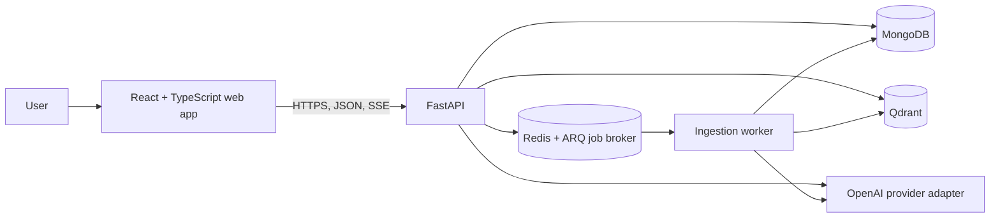

# Aristos — Engineering Knowledge Copilot

Aristos is a planned AI assistant for finding answers in engineering documentation. It is designed to retrieve relevant passages and provide answers with source citations that readers can inspect.

> **Project status:** Architecture approved; application implementation has not started. The features and workflows below describe the plan, not completed or deployed functionality.

## Project overview

Engineering teams rely on specifications, runbooks, design documents, and other technical references. Aristos aims to make that knowledge easier to search by letting users ask natural-language questions about documents they are authorized to share for processing.

The project is being designed as a portfolio-grade example of a retrieval-augmented generation (RAG) system, with explicit source grounding, document lifecycle handling, and evaluation of retrieval and citations.

## Problem statement

Finding a trustworthy answer in a collection of technical documents can require opening files, searching for terms, and checking whether a passage applies to the question. A general-purpose chatbot may answer without reliable evidence from those documents. Aristos is intended to connect answers to retrieved passages, show where those passages came from, and abstain when the available evidence is insufficient.

## Core features

**Planned; not yet implemented:**

- Upload PDF, Markdown, and plain-text documents.
- Extract and chunk document content while preserving PDF page references and useful structure such as headings and code blocks.
- Generate embeddings and index document chunks for semantic search.
- Ask questions about authorized, indexed documents and receive evidence-grounded answers.
- Display validated citations with document names, page numbers where available, and relevant passages.
- Maintain conversation history and stream answers.
- Evaluate retrieval quality, answer grounding, citation correctness, and latency.

## High-level architecture

The planned system is a React web client backed by a Python/FastAPI modular monolith and an asynchronous ingestion worker.



MongoDB is the application system of record. GridFS stores original uploaded files for the MVP. Qdrant stores derived chunk vectors and searchable payloads. Redis with ARQ dispatches ingestion jobs only; answer caching is not part of the MVP. OpenAI calls are planned behind provider adapters. The browser will communicate with the backend, not directly with databases or AI providers.

## Technology stack

All technologies below are **planned**; none are installed or wired up in this repository yet.

| Area | Planned technology |
|---|---|
| Frontend | React, TypeScript, Vite, Tailwind CSS |
| Backend | Python, FastAPI, Pydantic |
| Embeddings and generation | OpenAI through provider adapters |
| Vector search | Qdrant |
| Application data and source files | MongoDB and GridFS |
| Asynchronous ingestion jobs | Redis and ARQ |
| Local infrastructure | Docker Compose |

The initial proposed embedding model is `text-embedding-3-small`, configured through application settings. The chat model remains configurable and has not been selected. Initial chunk defaults (700 tokens with 100-token overlap) are experimental and must be evaluated.

## RAG workflow

The planned end-to-end workflow is:

1. A user uploads a PDF, Markdown, or TXT file and confirms they are permitted to share its contents with external API providers.
2. The backend validates the upload, stores original bytes in GridFS, and records metadata and job state in MongoDB.
3. Redis and ARQ dispatch an asynchronous job to the ingestion worker. The worker extracts and normalizes text, preserves page and structural information where possible, chunks the text, and requests embeddings through the OpenAI adapter.
4. The worker writes versioned chunk vectors and metadata to Qdrant. Only a complete active index is eligible for search.
5. For a question, the backend embeds the query, applies workspace and active-index metadata filters, and retrieves relevant chunks from Qdrant.
6. The backend supplies bounded retrieved context to the configurable chat model. It validates citation IDs against the retrieved chunks, constructs citation details from server-side metadata, and streams the answer and citations to the client.
7. If the retrieved context does not support an answer, the system should abstain rather than invent an answer or source.

## Repository structure

### Present in the repository

```text
Aristos/
  README.md
  .gitignore
  docs/
    ARCHITECTURE.md
```

There is currently no frontend, backend, infrastructure configuration, test suite, or application code. The future modular structure is described in [docs/ARCHITECTURE.md](docs/ARCHITECTURE.md); those planned paths do not exist yet.

## Prerequisites

No application runtime versions or package manager have been selected or pinned. There is no verified local runtime setup yet. The planned development environment will require suitable Python and Node.js runtimes and Docker with Compose for local services. Versions and exact tooling are to be decided before implementation.

## Local development setup

**Coming soon.** This repository does not yet contain application code, dependency manifests, Docker Compose configuration, or a verified development command. No install, run, or test commands can currently be provided without guessing.

The approved architecture describes the intended local services, but starting them is not currently possible from this repository.

## Configuration and environment variables

There is no application configuration or `.env.example` yet, and the architecture does not define literal environment variable names. Do not assume configuration keys from this README.

The architecture calls for future settings to cover the embedding model, configurable chat model, upload size limit, chunk size and overlap, retrieval budgets, and external service credentials. Exact names, defaults beyond those noted above, and local secret setup remain to be defined during implementation. Secrets must not be committed.

## Security and data privacy

- Public user access must remain disabled until a vetted authentication mechanism and workspace authorization are implemented. A development-only identity may be used locally, but not in a public deployment.
- Document content may be sent to OpenAI for processing only when the user is permitted to share that content with external API providers.
- Workspace authorization and filtering must be enforced by the backend for application records and vector retrieval.
- Provider credentials must stay out of browser code and source control.
- Uploaded documents are untrusted input. Retrieval context must be treated as evidence, not instructions; citations must be validated against retrieved chunks.
- Deletion and re-indexing must account for partial failures across MongoDB/GridFS and Qdrant, with retryable cleanup.

These are architectural requirements, not assurances about implemented controls. The application is not ready for public use.

## Testing and evaluation strategy

Testing and evaluation are planned and have not been implemented. The architecture calls for:

- Unit tests for extraction, normalization, chunking, indexing identifiers, retrieval filters, citation validation, lifecycle transitions, and error handling.
- Integration tests for MongoDB/GridFS, Qdrant, Redis/ARQ, provider adapters, retries, job recovery, re-indexing, deletion, and cross-workspace isolation.
- End-to-end tests for upload, processing, question answering, streaming citations, conversation history, and deletion.
- Retrieval metrics such as Recall@k, Precision@k, MRR, and nDCG; answer relevance and groundedness checks; citation precision/recall and abstention quality; and latency/cost measurements.

Evaluation data should use synthetic or otherwise permitted documents and avoid publishing confidential content.

## Roadmap

The approved implementation roadmap is sequential; each milestone requires implementation and verification before its Definition of Done can be claimed.

1. **Repository baseline and decisions:** repair repository documentation, select runtime versions and remaining authentication, privacy, model, and operational details.
2. **Local infrastructure and backend foundation:** introduce the API and worker foundation with local MongoDB, Qdrant, and Redis services.
3. **Document upload and ingestion:** implement validation, GridFS storage, ARQ jobs, extraction, chunking, embeddings, indexing, retries, re-indexing, and deletion cleanup.
4. **Grounded question answering:** add workspace-filtered retrieval, conversations, validated citations, abstention, and streaming.
5. **Minimal usable frontend:** implement upload, document status, chat, conversation history, and citation display.
6. **Evaluation and hardening:** measure retrieval and citation quality, address security and reliability, and document operational limits.
7. **Evidence-driven improvements:** consider reranking, OCR, hybrid retrieval, or other extensions only when evaluation or user feedback demonstrates a need.

See [docs/ARCHITECTURE.md](docs/ARCHITECTURE.md) for the detailed architecture, trade-offs, verification requirements, and milestone Definitions of Done.

## License

No `LICENSE` file is present, and a project license has not yet been selected. All rights are reserved by default until a license is chosen; do not assume this repository is available for reuse.
