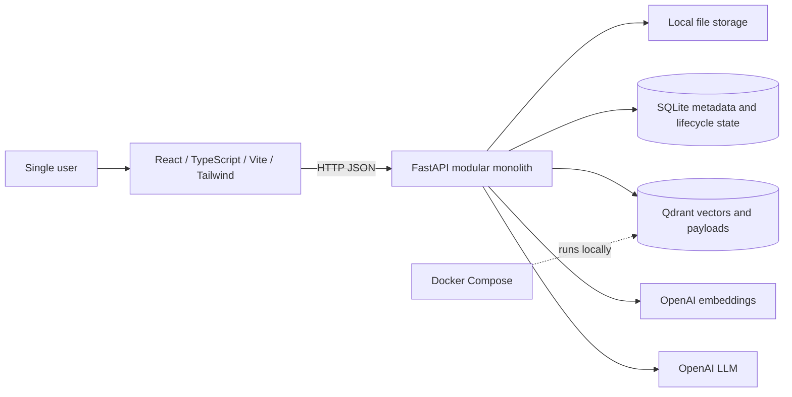

# Aristos Architecture

## 1. Product scope and status

Aristos is a single-user Engineering Knowledge Copilot. The MVP accepts PDF, TXT, and Markdown documents; lets the user ask questions; retrieves relevant passages; generates answers grounded in those passages with citations; and abstains when evidence is insufficient.

The repository currently has a FastAPI health endpoint and a minimal React landing screen. Everything beyond that scaffold—including document upload, persistence, ingestion, retrieval, answer generation, citations, abstention, deletion, and the UI workflow—is planned. This document describes target architecture and must not be read as a claim that those features exist.

## 2. Architecture at a glance



The browser communicates only with FastAPI. The API owns validation, synchronous use-case orchestration, retrieval, provider calls, citation checking, and response shaping. The modular monolith is one Python application organized into focused modules; it is not split into independently deployed services. Document ingestion runs synchronously in the request/application process. The MVP does not include a worker, queue, Redis, or asynchronous job lifecycle.

### Selected technologies

| Concern | MVP choice |
|---|---|
| Frontend | React, TypeScript, Vite, Tailwind CSS |
| API and validation | Python, FastAPI, Pydantic |
| Structured application state | SQLite |
| Original document bytes | Local file storage |
| Derived semantic index | Qdrant |
| Embedding and answer models | OpenAI embeddings and LLM |
| Local service orchestration | Docker Compose |

### Why SQLite and local files

The first release serves one user in a local/small-scale environment. SQLite provides durable, transactional metadata and document lifecycle state without requiring a separately administered database server, account system, or multi-user coordination. Local files provide a direct, inspectable place for source documents without introducing GridFS or object-storage configuration. Together they reduce setup and operational work while meeting the MVP's persistence needs.

These choices assume one application instance with access to its local data directory. They do not provide shared storage across replicas, managed backups, or multi-user isolation. If the product later needs those properties, storage can be reconsidered with evidence from actual scale and deployment needs. Qdrant is a separate vector store because semantic retrieval needs a vector index; it remains derived data that can be rebuilt from retained originals and the ingestion settings.

## 3. Module boundaries

Keep domain logic in one backend application with narrow, testable modules. Names may follow the existing scaffold, but responsibilities should stay explicit:

```text
backend/app/
  api/                 # HTTP routes and request/response contracts
  core/                # Pydantic settings, safe errors, shared configuration
  documents/            # upload validation, metadata, document lifecycle
  storage/              # local source files and SQLite repositories
  ingestion/            # extraction, normalization, chunking, embeddings, indexing
  retrieval/            # query embedding and Qdrant search
  answering/            # grounded prompt construction, LLM call, citations, abstention
  integrations/          # OpenAI and Qdrant client boundaries
```

Routes handle HTTP input/output. Pydantic validates request and response boundaries. Services implement user actions. Repositories and integration modules isolate SQLite, local files, Qdrant, and OpenAI operations. Avoid generic abstractions without a concrete testing or replacement need. Construct and close external clients through the FastAPI lifespan. Keep configuration and provider secrets server-side.

The frontend should remain a small feature-oriented React app with a typed API client, document upload/list/delete views, and a question/answer view with structured citations. No global state framework is required for this MVP.

## 4. Planned document ingestion flow

1. The user submits one PDF, TXT, or Markdown file to FastAPI.
2. Validate extension and content type, filename, actual byte count, and PDF structure where applicable. Reject unsupported or oversized inputs with a stable, safe error. Do not trust client-provided MIME type by itself.
3. Apply the preserved limits: 20 MiB upload; 300 PDF pages; 60 seconds extraction time; normalized output capped at 1 MiB UTF-8 and 100,000 counted input tokens, whichever comes first. Reject over-limit content instead of silently truncating it.
4. Save the original under an application-controlled local path and record its metadata and lifecycle state in SQLite. Do not use a user-supplied path directly.
5. Extract text, normalize line endings and repeated whitespace without flattening meaningful structure, and retain PDF page references where available. Empty or image-only PDFs fail clearly; OCR is out of scope.
6. Split by structure where feasible, initially using configurable 700-token chunks with 100-token overlap. Keep chunks within PDF pages when practical and associate page references with each chunk. These are experimental defaults, not a quality guarantee.
7. Request embeddings from OpenAI in bounded batches and upsert deterministic chunk points and metadata into Qdrant. This happens synchronously. Mark a document ready only after all chunks are successfully indexed and the local metadata state is updated. On failure, return an error and record a failed state where possible; do not report a partial index as ready.

The embedding model starts at configurable `text-embedding-3-small`. OpenAI is the only MVP model provider. Select a chat model and generation budgets before enabling answer generation. No provider credential belongs in frontend configuration, logs, or source control.

## 5. Planned question and answer flow

1. Validate the user's question and configured request limits.
2. Embed the question using the configured OpenAI embedding model.
3. Search Qdrant for the most relevant indexed chunks. Return only the context needed for the answer and retain server-side chunk/document/page metadata.
4. Ask the configured OpenAI LLM to answer using retrieved passages as evidence. Retrieved document text is untrusted data, not instructions; do not expose tools or actions to the model in the MVP.
5. Validate every citation identifier in the generated response against the passages actually retrieved. Build citation labels and page information from server-side metadata, not model-invented metadata.
6. If retrieval is empty or evidence is inadequate, return a clear abstention instead of an unsupported answer. The initial threshold/policy is basic and should be covered by core pipeline tests.
7. Return a normal JSON response with answer, abstention state if applicable, and structured citations. SSE streaming is out of scope.

## 6. Planned deletion and failure handling

Deletion is an essential document lifecycle operation. Mark the document unavailable in SQLite, delete its Qdrant points, remove the original local file, then record completion. Qdrant deletion should be filtered by stable document ID (and collection/index identity if used). Make each cleanup step idempotent.

SQLite and Qdrant do not share a transaction. If a cleanup step fails, retain enough non-content lifecycle state to report failure and permit a retry; do not claim deletion is complete while a vector or source file remains. Handle missing files and already-removed points as successful idempotent cleanup. Avoid adding a worker or retry service: expose/report a safe retry path as part of the application behavior, and keep recovery appropriate to a single-user MVP.

API errors must be handled consistently and must not expose stack traces, secrets, full provider responses, or document text. Validate all inputs at boundaries, apply timeouts to external calls, and keep logs free of document contents and credentials.

## 7. Configuration and security

Use Pydantic Settings for validated environment-based configuration. Provide a non-secret example file and document required variables, defaults, and which values are secrets. Load OpenAI credentials only in the backend process, keep real `.env` files out of version control, and fail clearly when a required secret is missing. Configure Qdrant endpoint/collection, upload and extraction limits, embedding/chat model names, and safe provider timeouts through settings. Do not add managed authentication or workspace membership: this is a single-user MVP. The application is for local/single-user access and must not imply public multi-user security guarantees.

Treat filenames and document content as untrusted. Restrict file paths to the configured storage root, use safe error messages, bound upload/extraction/provider work, and validate citation IDs. No compliance or production availability claim is implied.

## 8. Testing and completion evidence

The existing scaffold includes a health endpoint test. Planned API and core pipeline tests should cover:

- supported formats, malformed input, upload/page/text limits, and stable error handling;
- synchronous extraction, chunking metadata, and successful/failed index state;
- retrieval results feeding grounded generation;
- citation IDs restricted to retrieved chunks and abstention when evidence is insufficient;
- document deletion from SQLite/local storage/Qdrant, including idempotent cleanup and partial failures;
- configuration validation and assurance that secrets are not returned or logged.

These tests are planned and are not a claim of current coverage. Do not add a separate evaluation platform or advanced observability to the MVP.

## 9. Seven-day implementation roadmap

1. **Day 1 — Foundation:** confirm settings and secret handling; establish modular backend boundaries, SQLite schema/repositories, local storage root, and Docker Compose for Qdrant.
2. **Day 2 — Upload and validation:** implement document API/schema, supported format checks, safe filenames, 20 MiB/300-page limits, and local source plus SQLite metadata persistence.
3. **Day 3 — Synchronous ingestion:** implement extraction and text limits, page-aware chunking with 700/100 defaults, OpenAI embeddings, Qdrant writes, and ready/failed lifecycle handling.
4. **Day 4 — Retrieval and grounded answers:** implement question validation, vector search, configured OpenAI LLM generation, citation validation, and basic abstention.
5. **Day 5 — Frontend workflow:** connect upload, document list/deletion, question input, answer/citation display, and loading/error states.
6. **Day 6 — Deletion and tests:** complete recoverable vector/source cleanup and add API/core pipeline tests for validation, errors, retrieval, citations, abstention, and deletion.
7. **Day 7 — Integration and review:** exercise the full local workflow, resolve MVP defects, check configuration and secret handling, document limitations, and review scope completion.

This roadmap is a plan. Mark a feature complete only after it has been implemented and the relevant checks have passed.

## 10. Explicit MVP exclusions

MongoDB, GridFS, Redis, ARQ, managed authentication, multi-workspace support, background workers, reranking, SSE streaming, separately deployed microservices, Kubernetes, and advanced observability are outside the MVP. OCR, hybrid retrieval, additional providers, conversation history, and production hosting are also deferred unless separately approved.
