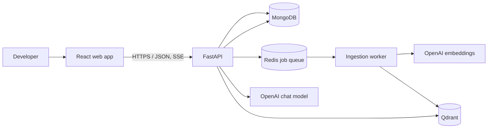

# Aristos — Engineering Knowledge Copilot

## Purpose and current repository

Aristos lets a developer upload engineering documents, ask questions about them, and receive answers grounded in retrievable passages with inspectable citations. The first useful release should prove the complete loop—upload, process, retrieve, answer, cite—before adding team administration or advanced retrieval features.

The repository is on branch `feature/architecture-blueprint` with a clean working tree. The only tracked files are `README.md` and `.gitignore`. Both currently contain literal PowerShell here-string commands (`@" ... "@ | Set-Content`) rather than their apparent Markdown/text contents. The README also has a mojibaked status emoji. This document does not alter those files; make repairing them the first implementation task.

## A. High-level architecture



The browser talks only to FastAPI. FastAPI owns authorization, validation, orchestration, and response shaping. MongoDB is the system of record for users, workspaces, document metadata, job state, conversations, and messages. GridFS stores original uploaded bytes in the MVP. Qdrant stores searchable chunk vectors and filterable payloads. Redis + ARQ dispatches asynchronous ingestion jobs only; Redis is not used for answer caching. A separate worker extracts, chunks, embeds, and indexes documents. The API performs retrieval and generation; it streams a response over Server-Sent Events (SSE).

Each store has one clear responsibility: MongoDB owns durable application records and authoritative lifecycle state; GridFS owns original file bytes; Redis transports ARQ jobs and short-lived queue state; Qdrant owns the derived vector index and chunk payloads. Qdrant can be rebuilt from retained source files and versioned settings. A document is available to retrieval only after a complete index version is committed and its MongoDB state is `ready`.

Keep these boundaries explicit: the browser never receives provider credentials or talks directly to databases; Qdrant is rebuildable from retained source documents and versioned ingestion settings; and a document is not marked `ready` until its vector points are successfully written.

## B. Frontend architecture

Use React + TypeScript + Vite + Tailwind CSS. Keep the first app as a small feature-oriented frontend rather than introducing a state-management framework preemptively.

```text
frontend/src/
  app/                 # Router, providers, application shell
  features/
    documents/         # Upload, document list, status, deletion
    chat/              # Conversation list, composer, streamed answer
  components/          # Shared buttons, dialogs, loading and error states
  lib/                 # Typed API client, SSE parser, common utilities
  types/               # API-facing TypeScript types
```

Feature components own feature-specific UI state; server data comes from a thin typed API client. Parse SSE events incrementally, render partial text, and render citations from structured source events rather than trying to parse citation prose from the answer. Show document processing states (`queued`, `processing`, `ready`, `failed`), retryable errors, and clear upload limits. Use accessible labels, keyboard-operable controls, and responsive layouts. Avoid a client-side global store until cross-feature state needs demonstrate one.

## C. FastAPI backend architecture

Use a modular monolith: one deployable API and one worker process share domain/service modules and configuration. Routes handle HTTP concerns, schemas validate boundaries, services implement use cases, and repositories isolate MongoDB/Qdrant access. Do not create generic interfaces for every class; add abstractions where they enable testing or replaceable infrastructure.

```text
backend/app/
  main.py              # App construction, lifespan, middleware, router mounting
  api/v1/              # Route modules and dependency wiring
  core/                # Settings, auth, logging, errors, request IDs
  schemas/             # Pydantic request/response/event models
  models/              # Mongo document representations and enums
  services/            # Document, conversation, chat use cases
  rag/                 # Retrieval, context building, generation, citations
  ingestion/           # Extraction, cleaning, chunking, indexing
  repositories/        # Mongo and Qdrant persistence operations
  integrations/        # OpenAI, MongoDB, Qdrant, Redis clients
  worker/              # Queue registration and ingestion job entry point
  prompts/             # Versioned prompt templates
tests/
  unit/                # Pure service and transformation behavior
  integration/         # Mongo/Qdrant/Redis and provider boundaries
  e2e/                 # API-level user workflows
evals/                 # Versioned retrieval and answer evaluation cases
```

Use Pydantic settings for environment configuration and Pydantic schemas for HTTP contracts. Instantiate network clients through the app/worker lifespan and close them cleanly. Keep provider calls behind narrow integration modules to enforce timeouts, retries, model selection, and safe logging centrally.

## D. Document ingestion architecture

1. Authenticate and authorize workspace access before accepting a file. Authentication is unavailable to public users until a vetted authentication mechanism and workspace authorization are implemented. A development-only identity may be enabled locally and must be impossible to enable in public deployments. Validate extension, MIME type, byte limit, filename, and file signature where useful. Initially accept PDF, Markdown, and TXT only; reject archives and executables. Enforce a configurable 20 MiB initial upload limit.
2. Before processing content, require that the uploader is permitted to share the document with external API providers. OpenAI processing must not occur without that permission. Store original bytes in MongoDB GridFS for the MVP and metadata/state in MongoDB. Keep the file storage boundary narrow for a future object-storage migration.
3. Create a document record and ingestion job record with stable IDs and enqueue an idempotent ARQ job. Return `202 Accepted` with document and job IDs. MongoDB is authoritative for job/document state; Redis is the broker and transient delivery mechanism, not the only record of pending work.
4. The worker atomically claims an eligible MongoDB job using a lease/claim token and moves an initially ingested document to `processing`. Duplicate deliveries are expected: derive a stable idempotency key from document ID + target index version and make each stage safe to repeat. Use bounded exponential backoff with jitter for transient network/provider/database failures. Do not retry permanent validation, unsupported format, or permission failures. After the configured attempt limit, mark the job `failed`; mark the document `failed` only if it has no usable ready index. If a re-index failed, keep the prior document index `ready` while recording the failed target version/job, retain a safe error code, and expose a manual retry operation that creates/requeues a new attempt.
5. Extract with PyMuPDF, preserving page boundaries and page numbers; retain headings and code blocks wherever possible. Decode Markdown/TXT as UTF-8 with a clear error for unsupported input. Normalize line endings and repeated whitespace without flattening meaningful paragraphs, headings, code, or useful table text.
6. Split by structure where possible. Initial experimental defaults are 700 tokens per chunk and 100-token overlap, configurable through settings and recorded with the index version; evaluation must determine whether they are suitable. Keep chunks within one PDF page when feasible and record page spans for cross-page chunks. These are starting hypotheses, not quality claims.
7. Generate embeddings through the OpenAI provider adapter in bounded batches, then upsert Qdrant points with deterministic IDs and payload. Mark the target index version complete and the document `ready` only after all points are verified/written and MongoDB state is updated. Empty or image-only PDFs fail clearly; OCR is out of scope initially.
8. **Re-indexing:** Keep the prior ready index available while building a new version in a separate version/collection. Track the target version and progress in MongoDB. Once all new points succeed, atomically switch the document's active index version, then delete old points. If indexing fails, retain the previous ready version and mark the new attempt failed. Retry cleanup of old points asynchronously; orphan cleanup is safe because point payloads include workspace, document, and version IDs.
9. **Deletion:** Mark the document `deleting` and deny new retrieval/use immediately. Run an idempotent cleanup job that deletes Qdrant points for all versions and removes the GridFS source, then tombstones/deletes MongoDB metadata according to retention policy. MongoDB and Qdrant/GridFS do not share a transaction, so record cleanup progress and retry each unfinished operation. A partial failure remains `deleting`/`cleanup_pending`, never falsely `deleted`; reconciliation repeats safe cleanup until complete. Keep citation snapshots in existing conversation history per retention policy, but do not retain source bytes or vectors after deletion completes.

### Lifecycle states and recovery

Document states: `queued` (accepted, awaiting initial worker), `processing` (initial indexing is active), `ready` (an active complete index exists; a re-index may run alongside it), `failed` (initial indexing failed and no usable index exists; explicit retry is allowed), `deleting` (not retrievable; cleanup underway), and `cleanup_pending` (one or more stores still need cleanup). A failed re-index is recorded on its job/target version while the previous usable document remains `ready`. State transitions are validated in MongoDB; only `ready` documents are searchable, and deletion immediately removes a document from retrieval eligibility.

Chunks are derived artifacts, not independent MongoDB records. During ingestion, chunks are `staged` in worker memory, then `indexed` under a target Qdrant index version. They become `active` only when MongoDB switches the document's active version after the complete target set is verified. On re-index, the previous version remains active while the new one is staged/indexed; after cutover, old chunks are `obsolete` until cleanup deletes them. Partial target versions are never retrieved and are retried or removed by reconciliation. Search filters must include the document's active index version, in addition to workspace and document filters.

Job states: `queued`, `running` (lease and heartbeat recorded), `retry_wait` (transient failure with next eligible time), `succeeded`, `failed` (attempt limit reached or permanent failure), and `cancelled` (for deletion/superseded work). Every transition records attempt count, timestamps, safe error code, and target index version. ARQ delivery is treated as at-least-once; correctness comes from MongoDB claims, idempotency keys, deterministic Qdrant point IDs, and idempotent deletion—not a claim of exactly-once execution.

On API startup, a reconciliation task scans MongoDB for queued jobs that are missing from Redis and re-enqueues them idempotently. On worker startup and periodically, reconciliation finds expired `running` leases, returns transient jobs to `retry_wait`/`queued`, and enqueues eligible work. It also finds documents stuck in `processing`, `deleting`, or `cleanup_pending`, superseded index versions with incomplete cleanup, and job records with no matching document; repair or quarantine them with a recorded reason. Reconciliation must use bounded batches and atomic claims to avoid competing API/worker instances duplicating state transitions. Graceful shutdown stops accepting new jobs, lets active work finish for a bounded timeout, then releases/lets leases expire and closes provider/database/Redis clients. A forced termination is recovered through expired-lease reconciliation.

Failure scenarios include Redis downtime during enqueue (persist Mongo job first, return a retryable service error or accepted-pending result, and rely on reconciliation); Redis loss after enqueue (re-enqueue from Mongo); worker crash during extraction or embedding (lease expires and idempotent retry resumes/rebuilds the target version); partial Qdrant batch write (repeat deterministic upserts, verify expected point count); Mongo outage after Qdrant write (do not mark ready; retry/reconcile); OpenAI timeout/rate limit (bounded exponential backoff); permanent OpenAI/auth/configuration failure (fail without endless retries); and deletion interruption in any store (retain cleanup state and retry). Avoid deleting source or prior ready vectors until a replacement index is complete.

The source document and chunk text must be retained (with access controls) because cited passages need to be returned exactly and indexes need rebuilding. Define retention and maximum upload limits before public deployment.

## E. Retrieval and generation pipeline

For each question:

1. Authenticate, enforce workspace membership, validate message length, and load conversation state. Resolve follow-up context from a bounded recent message window; do not send an unbounded transcript.
2. Embed the current question through the OpenAI embedding provider adapter using the same model/version as indexed chunks. Initial proposed model: `text-embedding-3-small`, configurable through environment settings. Fail clearly if embedding configuration does not match the active index.
3. Resolve eligible documents and their active index versions from MongoDB, then search Qdrant with mandatory `workspace_id` and active `index_version` filters plus optional selected-document filters. Retrieve an initial top 20 candidates (configurable), using cosine similarity and a relevance threshold tuned by evaluation. Never search partially indexed target versions.
4. Start with dense vector retrieval and metadata filtering. Reranking is deferred until evaluation demonstrates a retrieval-quality need. First inspect ranked results and tune chunking, filters, and candidate count. A reranker adds latency, cost, and another provider/model dependency.
5. Build bounded context from the best 5–8 chunks (configurable) and assign request-local source IDs (`S1`, `S2`, …). Include document name, page, passage, and chunk ID. Treat retrieved content as untrusted data/instructions, delimit it, and tell the model to use it only as evidence.
6. Ask the model to answer only from supplied evidence, cite factual claims with provided IDs, and abstain when retrieved context is insufficient. Stream answer text. Validate every citation ID against the retrieved chunk set and construct citation objects exclusively from server-side metadata. Reject/drop all unknown IDs; never allow a model-generated document name, page, or passage to become a source reference.
7. Return source objects containing document ID/name, page number(s) when available, exact supporting passage, and chunk ID. If the model cites no valid source for a factual response, do not fabricate one: instruct it to abstain or return a groundedness error policy. Keep cited passages visible beside the answer.
8. Persist user and completed assistant messages with citations and model/prompt/index versions. For interrupted streams, persist a defined incomplete status or discard the partial assistant message; choose one behavior consistently.

Keep OpenAI behind provider adapters for embeddings and chat generation, so request limits, errors, timeouts, and provider details are isolated. Use `text-embedding-3-small` as the initial proposed embedding model, configured through environment settings and recorded with every index. Keep the chat model configurable through environment settings; do not place an unverified model identifier in code or this architecture. Record model and prompt versions for reproducibility.

## F. MongoDB data model

Use MongoDB ObjectIds (or UUIDs consistently) and UTC timestamps. Every user-owned record carries a `workspace_id`; every query enforces it. Add compound indexes for common filters and TTL indexes only for explicitly temporary records.

| Collection | Important fields | Indexes / purpose |
|---|---|---|
| `users` | `_id`, `email`, `password_hash` (only if local auth is selected), `created_at`, `status` | Unique normalized email. Identity provider integration is a later decision. |
| `workspaces` | `_id`, `name`, `created_by`, `created_at` | Workspace boundary for ownership and future sharing. |
| `memberships` | `workspace_id`, `user_id`, `role`, `created_at` | Unique `(workspace_id, user_id)`; role checks. |
| `documents` | `_id`, `workspace_id`, `uploaded_by`, `original_name`, `media_type`, `size_bytes`, `blob_id`, `sha256`, external-processing permission record, `status`, `failure_code`, `chunk_count`, active/target index versions, `embedding_model`, timestamps | `(workspace_id, status)`, `(workspace_id, created_at)`; metadata, consent evidence, and lifecycle. |
| `ingestion_jobs` | `_id`, `workspace_id`, `document_id`, `state`, `idempotency_key`, `target_index_version`, `attempts`, `next_attempt_at`, lease/heartbeat fields, `last_error_code`, timestamps | `(state, next_attempt_at)`, `(document_id, state)`, unique idempotency key; durable job ledger for reconciliation, not the queue itself. |
| `conversations` | `_id`, `workspace_id`, `owner_user_id`, `title`, timestamps, `status` | `(workspace_id, owner_user_id, updated_at)`; list history. |
| `messages` | `_id`, `workspace_id`, `conversation_id`, `role`, `content`, `citations[]`, `model`, `prompt_version`, `status`, `created_at` | `(conversation_id, created_at)`; persist each message separately to avoid unbounded conversation documents. |

Store GridFS bucket records separately from document metadata. MongoDB is the authoritative record for document, job, and index-version state; GridFS is only the original file-byte store. Store citation snapshots (document ID/name, page, passage, chunk ID) with assistant messages so history remains meaningful if a document is later deleted; make this behavior explicit in retention policy. MongoDB is not used as a substitute vector index. Redis/ARQ is only job transport, not the authoritative job ledger and not an answer cache.

Authentication is a release decision: select a vetted identity provider or library before any public release. Never implement custom token cryptography. For local development, a clearly isolated development-only identity can avoid building sign-up before core RAG, but it must not be exposed in production.

## G. Qdrant collection design

Use one collection per embedding model/dimension/index generation, e.g. `aristos_chunks_v1`. Re-index into a new version and switch active version only after the replacement is complete. A point is one chunk:

```json
{
  "id": "stable-uuid",
  "vector": ["embedding floats"],
  "payload": {
    "workspace_id": "...",
    "document_id": "...",
    "chunk_id": "...",
    "document_name": "...",
    "page_start": 12,
    "page_end": 12,
    "heading_path": ["Setup", "Configuration"],
    "content_type": "prose",
    "text": "Exact normalized passage text",
    "index_version": "v1",
    "embedding_model": "configured-model"
  }
}
```

Use cosine distance and configure vector dimensions to match the selected model. Create payload indexes for `workspace_id`, `document_id`, and any frequently filtered scalar fields. Always include workspace filtering in application search code; do not rely on callers to supply it. Use deterministic point IDs from document ID + index version + chunk ordinal or stable hashes. Keep payload text bounded by chunk limits. Re-indexing to a new model/dimension uses a new collection and cutover after successful indexing; document a cleanup policy for old collections.

## H. API design

All endpoints use `/api/v1`. JSON errors share `{ "error": { "code", "message", "request_id", "details?" } }`. Public user routes must not be exposed until a vetted authentication mechanism and workspace authorization are implemented. A development-only identity may be used locally and must be disabled in public deployment. Authorize workspace membership and role server-side on every operation. The table describes the API contract; auth provider selection remains open.

| Method and path | Responsibility | Auth |
|---|---|---|
| `GET /health/live` | Process liveness only | None, minimal response |
| `GET /health/ready` | Dependency readiness without leaking secrets | Internal/none, deployment protected |
| `POST /api/v1/workspaces` | Create workspace | Authenticated |
| `GET /api/v1/workspaces` | List memberships/workspaces | Authenticated |
| `POST /api/v1/workspaces/{workspace_id}/documents` | Multipart upload, create record/job, return `202` | Member with upload permission |
| `GET /api/v1/workspaces/{workspace_id}/documents` | List documents and processing status | Workspace member |
| `GET /api/v1/workspaces/{workspace_id}/documents/{document_id}` | Metadata/status | Workspace member |
| `DELETE /api/v1/workspaces/{workspace_id}/documents/{document_id}` | Start/perform idempotent deletion; return `202` if async | Workspace admin/owner |
| `POST /api/v1/workspaces/{workspace_id}/documents/{document_id}/retry` | Retry failed indexing | Workspace member with upload permission |
| `POST /api/v1/workspaces/{workspace_id}/conversations` | Create conversation | Workspace member |
| `GET /api/v1/workspaces/{workspace_id}/conversations` | List caller's conversations, paginated | Workspace member; ownership enforced |
| `GET /api/v1/workspaces/{workspace_id}/conversations/{id}/messages` | Read history | Owner or authorized workspace role |
| `POST /api/v1/workspaces/{workspace_id}/conversations/{id}/messages:stream` | Persist question, retrieve/generate, stream answer/citations as SSE | Conversation owner/member |

Upload request includes the file and optional display name. Chat request includes `{ "content": "...", "document_ids": [] }`; conversation ID is in the path. SSE event contract:

```text
event: message.started\ndata: {"message_id":"..."}
event: answer.delta\ndata: {"text":"..."}
event: citations\ndata: {"items":[{"source_id":"S1","document_id":"...","document_name":"...","page_start":12,"page_end":12,"passage":"...","chunk_id":"..."}]}
event: message.completed\ndata: {"message_id":"...","status":"completed"}
event: error\ndata: {"code":"...","message":"...","request_id":"..."}
```

Use pagination cursors for lists. Do not expose raw database errors or provider responses. Keep API schemas versioned and return stable error codes.

## I. Streaming response architecture

Use FastAPI `StreamingResponse` with `text/event-stream`. Authenticate and authorize before starting the stream, validate the conversation and selected documents, and persist the user message before generation. Send periodic SSE comments as heartbeats through a proxy-friendly timeout. The backend streams provider deltas as `answer.delta`, then validated citation metadata and a terminal event. On disconnect, cancel provider work where supported, close the stream, and record a consistent interrupted status. Never send secrets, internal prompts, or unvalidated model tool arguments to clients. The frontend reconnect policy should not silently submit a duplicate question; use message IDs/idempotency keys if retry is offered.

## J. Error handling and security

- **Secrets:** Read OpenAI, database, and signing secrets from environment or deployment secret storage. Provide only a sanitized example environment file later; never log secrets or commit real values. Configure embedding model (`text-embedding-3-small` initially proposed), chat model, upload limit (20 MiB initially), chunk size/overlap, and retrieval budgets through validated settings.
- **Authentication and authorization:** Public user routes stay disabled until a vetted mechanism and workspace authorization are in place. Enforce identity and membership in backend dependencies/services. Scope every MongoDB and Qdrant query to workspace. Use secure, HTTP-only, SameSite cookies if browser sessions are used; add CSRF protection. If bearer tokens are used, validate issuer, audience, expiration, and signature through a trusted library. A development-only identity must be guarded by an explicit local environment mode.
- **Uploads:** Set byte and request limits at proxy and app layers, validate extension and content, use generated storage IDs, sanitize displayed names, reject malformed PDFs, and avoid decompression/archive support. PDFs are untrusted input; keep parsing libraries patched and isolate worker resources/time.
- **Prompt injection:** Treat document passages as data, not instructions. Do not grant the model tools or actions in the MVP. Require evidence-based answers, restrict citation IDs to retrieved results, and keep workspace filtering outside model control.
- **Data isolation:** Deny by default; test cross-workspace document, conversation, and citation access. Avoid relying on client-supplied IDs for authorization.
- **Abuse/cost:** Bound file size, page count, question length, context tokens, model output tokens, concurrent jobs, and request rate. Add per-user/workspace quotas before public access. Do not cache sensitive answers across users.
- **Reliability:** Apply connection/request timeouts, bounded exponential backoff with jitter for transient provider/database errors, idempotent ingestion, graceful worker shutdown, expired-lease recovery, and periodic MongoDB-to-Redis reconciliation. Do not retry validation/permission errors. Deletion and re-index cleanup are retryable sagas because MongoDB, GridFS, Redis, and Qdrant do not share transactions. Make readiness checks distinguish dependency failure from process liveness.
- **Observability:** Structured logs with request/job IDs, durations, model and index version, counts and safe error codes. Never log document contents, prompts with private material, auth headers, or API keys by default. Track ingestion duration, retrieval latency, generation latency, failure rate, token usage, and stream disconnects.
- **Errors:** Map validation (400/422), unauthenticated (401), unauthorized (403), missing (404), conflict/state (409), too large (413), rate/quota (429), and transient service failures (503) to stable response codes. SSE errors use the same codes and terminate the stream.

## K. Docker Compose and service communication

The planned local Compose topology has `frontend`, `api`, `worker`, `mongodb`, `qdrant`, and `redis`. API and worker share backend image/code and configuration. Only frontend/API ports need host exposure for local use; database and queue ports remain on the Compose network unless a developer explicitly needs local tooling. Services connect by Compose DNS names, not `localhost` (for example `mongodb:27017`, `qdrant:6333`, `redis:6379`). Use health checks and dependency readiness, persistent named volumes for MongoDB/Qdrant and optionally Redis queue data, and `.env` supplied locally but ignored by Git. Do not expose Qdrant's unauthenticated development port publicly. Compose is local development, not a full production deployment or secret manager.

## L. Testing strategy

- **Unit:** Text normalization, page-aware chunking, stable IDs, metadata filters, context budgeting, citation-ID validation, state transitions, auth policy, and error mapping. Mock provider boundaries; keep pure functions deterministic.
- **Integration:** Use isolated MongoDB, Qdrant, and Redis instances (containerized in CI or equivalent). Verify GridFS lifecycle, ARQ delivery/retries/idempotency, exponential backoff bounds, failed-job recovery, graceful shutdown, Redis/worker interruption and reconciliation, partial Qdrant writes, re-index cutover, deletion cleanup retries, payload indexes/filters, and mocked OpenAI adapter contracts. Explicitly test cross-workspace isolation for document listing/download/deletion, Qdrant retrieval, conversations, messages, and citations. Avoid depending on live provider calls in routine CI.
- **End-to-end:** Upload a fixture PDF/Markdown/TXT; observe queued→processing→ready; ask a question; assert SSE terminal event, grounded citation passage/page, and persisted history; verify deletion removes retrieval results. Include unauthorized and cross-workspace attempts.
- **Frontend:** Component tests for upload/chat/status/error states and SSE parsing; browser E2E for the core workflow after the app exists.
- **Quality gates:** Format, lint, and type-check each language; keep fixture documents small and synthetic. Add tests alongside each milestone and run the smallest relevant suite during development, full suite before release.

## M. RAG evaluation framework

Maintain a small versioned evaluation dataset of representative engineering questions, expected relevant document/chunk labels, expected answer points, and citation support spans. Avoid embedding confidential documents in a public repository. Establish a baseline before tuning.

Measure:

- **Retrieval:** Recall@k, Precision@k, MRR, and/or nDCG on labeled relevant chunks; report by query type, document size, and metadata filter. Compare dense retrieval settings before considering reranking.
- **Answer:** Human-rated relevance, correctness, completeness, and abstention quality; optionally use a model judge as a noisy diagnostic, not ground truth.
- **Grounding/citations:** Claim support rate, citation precision and recall, source passage overlap or reviewer correctness, evidence-based abstention quality, and invalid citation ID rate. Unknown citation IDs are rejected by construction; evaluation still asserts zero returned fabricated references.
- **Operations:** p50/p95 ingestion and query latency, embedding/generation token cost, failure rate, queue age, and stream completion rate.

Evaluate a fixed corpus and fixed query set when changing chunking, embedding model, retrieval count, prompts, or reranking. Record configuration/model/index versions with results. Do not optimize a single aggregate score at the expense of correct abstention or citation precision.

## Technology decisions and trade-offs

| Decision | Recommendation and reason | Alternative / trade-off |
|---|---|---|
| React, TypeScript, Vite, Tailwind | Keep the approved stack; fast local iteration and typed API integration. | A server-rendered framework is unnecessary for the initial single-page tool. |
| FastAPI, Pydantic | Keep; Python ecosystem fits document/RAG work, async HTTP and explicit schemas. | A separate service per domain adds deployment/coordination cost without current scale. |
| MongoDB + GridFS | MongoDB is the application system of record; GridFS stores original document bytes in the MVP. | Object storage may improve large-scale blob lifecycle/cost; migrate behind storage boundary when deployment needs justify it. |
| Qdrant | Keep for vector search plus payload filtering and local Docker use. | Mongo vector search or hosted vector DB would reduce/shift operations but change capabilities/deployment constraints. |
| OpenAI | Use provider adapters. Propose `text-embedding-3-small` initially via settings; keep chat model configurable without an unverified identifier. Send uploaded content only with user permission to share it with external API providers. | Local/open models improve control but add hardware/serving and quality work; provider portability is not free. |
| Redis + ARQ | Approved for asynchronous ingestion jobs only. MongoDB remains authoritative; use idempotency, exponential backoff, failed-job recovery, graceful shutdown, and reconciliation after interruptions. Do not implement answer caching. | In-process work can be lost on API restart and couples worker/API capacity. A Mongo-polled queue requires custom leasing/polling logic. Redis adds operational work. |
| Chunking/reranking | Start with page/structure-aware token chunking, vector search and metadata filters; introduce reranking only when evaluation shows a need. | Reranking can improve ordering but adds latency, cost, and model operations. |
| Authentication | Public access is gated on a vetted auth mechanism and workspace authorization. Development-only identity is local-only. | Choose OIDC or vetted local auth before public exposure; custom token cryptography is not acceptable. |
| OCR / object storage / Kubernetes | Defer. None is required to demonstrate the first end-to-end user workflow. | Add when image-only PDFs, scale, or deployment environment demands it. |

## Proposed repository structure

```text
Aristos/
  README.md                    # Project overview, setup, status
  .gitignore
  docs/
    ARCHITECTURE.md            # This blueprint
  frontend/
    package.json
    vite.config.ts
    src/
      app/
      features/
        documents/
        chat/
      components/
      lib/
      types/
    tests/
  backend/
    pyproject.toml
    app/
      main.py
      api/v1/
      core/
      schemas/
      models/
      services/
      rag/
      ingestion/
      repositories/
      integrations/
      worker/
      prompts/
    tests/
      unit/
      integration/
      e2e/
  evals/
    README.md                  # Dataset format and safe evaluation procedure
    cases/                     # Synthetic or permitted evaluation cases
  infra/
    docker-compose.yml         # Add when implementation begins
    docker/                    # Images and service-specific container config
```

Keep shared API contracts documented first; generate an OpenAPI client only if manual TypeScript types become error-prone. Do not add a separate shared package until duplication demonstrates a maintenance problem.

## Implementation roadmap

### 0. Repository baseline and decisions

- **Objective:** Make the existing repository usable and settle implementation-blocking choices.
- **Tasks:** Replace literal PowerShell content in README and `.gitignore` with their intended plain text; preserve useful existing entries. Confirm supported Python/Node versions, vetted authentication mechanism, configurable chat model, PDF page/token/cost limits, external-provider consent UX, retention, and license/privacy assumptions. Configure the 20 MiB upload limit and experimental chunk defaults through settings. Add agreed project documentation and minimal formatting/lint configuration only when implementation is authorized.
- **Dependencies:** Architecture review.
- **Deliverables:** Clean README/ignore files; agreed version and environment contract.
- **Verification:** Inspect file contents and Git diff; no secrets tracked.
- **Definition of Done:** A fresh developer can understand the project and agreed decisions are recorded.

### 1. Local infrastructure and backend foundation

- **Objective:** Start API, worker dependencies, and databases locally.
- **Tasks:** Create Compose services for MongoDB, Qdrant, Redis; FastAPI settings/lifespan, health endpoints, logging/error envelope, database clients, and minimal API skeleton.
- **Dependencies:** Milestone 0; Docker availability.
- **Deliverables:** Repeatable local startup and backend skeleton.
- **Verification:** Health/readiness behavior and dependency connectivity; configuration failure is clear.
- **Definition of Done:** Services start from documented commands, persist local data, and expose no secrets.

### 2. Document upload and ingestion

- **Objective:** Accept supported files and make searchable chunks.
- **Tasks:** Add vetted auth/workspace baseline before public routes (local-only development identity is acceptable), provider-sharing permission checks, upload validation, GridFS storage, Mongo document/job/index-version metadata, Redis + ARQ worker, PDF/Markdown/TXT extraction, normalization, experimental configurable chunking, embeddings, Qdrant indexing, state transitions, idempotency, backoff, reconciliation, retry, re-index and deletion cleanup lifecycle.
- **Dependencies:** Milestone 1; OpenAI credentials.
- **Deliverables:** Upload/status/list/delete API and working ingestion worker.
- **Verification:** Unit chunk fixtures; integration lifecycle, duplicate delivery, idempotent retry, failed-job recovery, interruption/reconciliation, partial cleanup and cross-workspace isolation; invalid/empty/oversized and provider-permission-denied cases.
- **Definition of Done:** A permitted supported document reaches `ready` only after a complete index; failure/restart recovers safely; deletion removes source and every vector or remains visibly retryable until cleanup completes.

### 3. End-to-end grounded question answering

- **Objective:** Ask questions over indexed documents and return trustworthy citations.
- **Tasks:** Conversation/message persistence; workspace-filtered retrieval; context assembly; grounded prompt; citation validation; SSE stream and client contract; abstention behavior.
- **Dependencies:** Milestone 2; chat model credentials.
- **Deliverables:** Chat, history, streaming API, source passages/pages.
- **Verification:** Integration/E2E supported answer, insufficient evidence abstention, citation validity, workspace isolation, disconnect/error cases.
- **Definition of Done:** A user can upload a fixture, ask a question, see a streamed answer with matching source passage, and revisit the conversation.

### 4. Minimal usable frontend

- **Objective:** Complete the primary user workflow in a browser.
- **Tasks:** React shell, typed client, upload/list/status/delete UI, conversation list, chat composer, SSE rendering, citation display, loading and error states, responsive/accessibility pass.
- **Dependencies:** Milestone 3 API contract.
- **Deliverables:** Functional local web app.
- **Verification:** Component tests and browser E2E for the core flow.
- **Definition of Done:** The workflow needs no manual API calls and errors/status are understandable.

### 5. Evaluation and hardening

- **Objective:** Establish evidence for retrieval quality and safer operation.
- **Tasks:** Curate synthetic evaluation set; calculate retrieval and citation metrics; tune chunk/retrieval settings; request limits, quotas, rate limiting, timeouts, structured logs, security review, backups and deletion policy.
- **Dependencies:** Milestones 2–4 and representative corpus.
- **Deliverables:** Repeatable eval report and documented operational limits.
- **Verification:** Baseline and regression run; abuse and isolation tests.
- **Definition of Done:** Quality is measurable, regressions visible, and known limits documented.

### 6. Optional improvements (only driven by evidence)

- **Objective:** Address demonstrated product or scale gaps.
- **Candidates:** Reranking, OCR, object storage, OIDC/team administration, answer caching, hybrid search, observability dashboards, deployment automation.
- **Dependencies:** Evaluation or user feedback identifies a need.
- **Deliverables and Definition of Done:** One scoped improvement at a time with before/after measurement, tests, and rollback path.

For one student developer, milestones 0–4 form a reasonable first portfolio release; prioritize the ingestion and citation loop over polish or advanced models. Keep each milestone small enough to complete and demonstrate independently.

## Architectural risks and open decisions

1. **Identity/authentication:** Select the vetted auth mechanism/provider and workspace role policy before exposing public routes.
2. **Data privacy/retention:** Define the permission UX and audit behavior for sharing document contents with OpenAI, plus deletion and conversation citation-snapshot retention.
3. **Models and budgets:** Choose a configurable chat model and maximum context/output token budgets. The embedding proposal is `text-embedding-3-small`; confirm at implementation time. Decide PDF page cap and per-user/workspace cost controls.
4. **Operational recovery:** Set lease duration, retry count/backoff ceiling, reconciliation interval, and cleanup alerting thresholds during implementation; the architecture specifies recovery behavior but not deployment-specific values.
5. **Citation fidelity:** PDF text extraction can lose reading order or table meaning. Preserve page-level passages and evaluate with real representative documents; OCR/tables are explicitly out of initial scope.
6. **Index lifecycle:** Model/dimension changes require collection versioning and rebuild/cutover. Document migration and orphan cleanup before changing embeddings.
7. **Prompt injection and cross-tenant leakage:** Retrieved text is adversarial input and filters are security boundaries; include tests for both.

## Decisions requested before implementation

The architecture and the following choices are approved: React + TypeScript + Vite + Tailwind; Python + FastAPI modular monolith; MongoDB as application system of record; GridFS for MVP source files; Qdrant for vectors; Redis + ARQ for ingestion jobs only; OpenAI provider adapters; proposed `text-embedding-3-small` embedding model; configurable chat model with no hardcoded unverified ID; 20 MiB configurable upload limit; experimental 700-token chunk / 100-token overlap defaults; dense retrieval with metadata filtering before any evidence-driven reranking; validated citations and evidence-based abstention; and external-provider processing only with user permission.

The remaining implementation decisions are:

- Which vetted authentication mechanism/provider and workspace role policy to use before public access.
- How the product will obtain, record, and enforce user permission to send each document to an external provider; which chat model and token/cost budgets to configure.
- The maximum PDF page count, queue lease/retry/reconciliation settings, and document/conversation retention policy.

The architecture does not authorize implementation by itself. Wait for the user's implementation approval after these remaining decisions are resolved.

## Exact first implementation task

After the architecture and remaining decisions are approved, repair `README.md` and `.gitignore`: replace the literal PowerShell here-string bodies with their intended plain-text contents, fix the README mojibake, and inspect the diff to ensure it contains only those repairs. Then record the agreed Python/Node versions and auth/model choices before scaffolding the backend.
